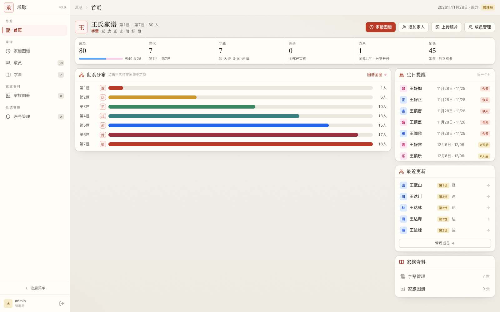
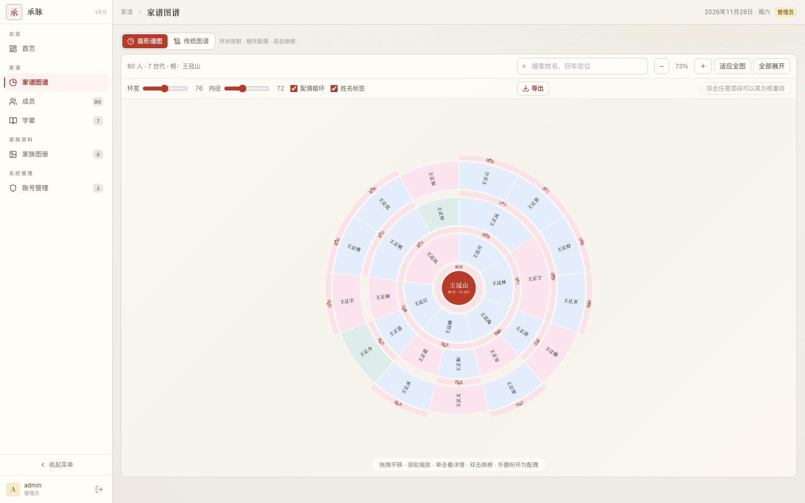
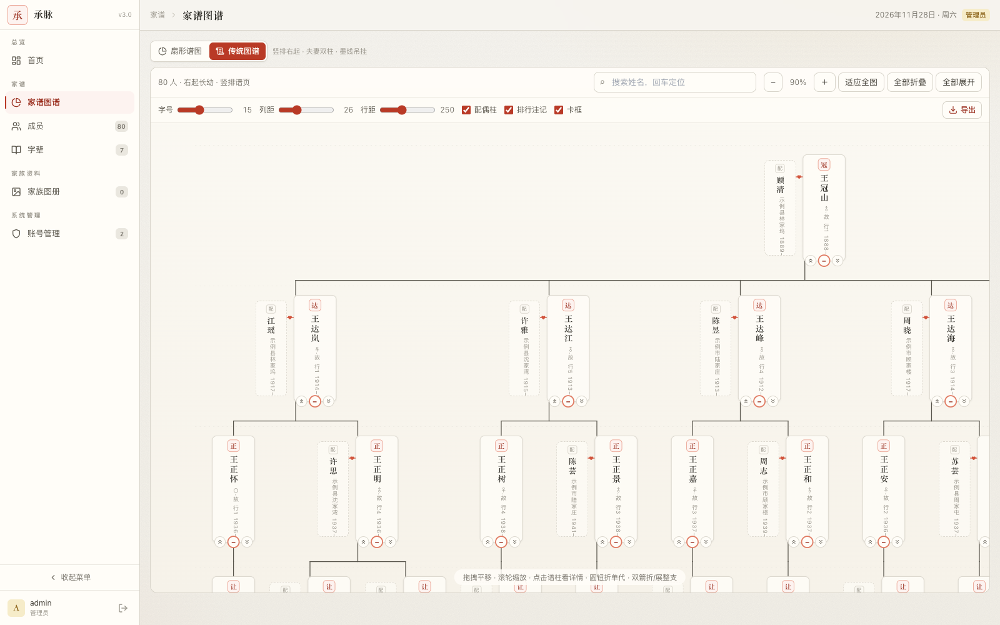

# 承脉 ChengMai

面向家族世系记录的全栈应用。前端为纯静态产物，后端为单 jar Java 服务，数据保存在本地 SQLite 与文件目录中，无需外部数据库或容器。

## 核心功能

- **家族档案**：成员增删改查、父母子女关系、农历生日、字辈与同辈排行、批量维护。
- **家谱图谱**：扇形与传统双风格，支持配偶、折叠分支、缩放定位、双击换根及 JSON / SVG / PNG / PDF 导出。
- **家族图册**：图片上传、缩略图、标签与审核流程。
- **协作管理**：admin / editor / viewer 三档权限、操作审计、账号管理。
- **家族总览**：成员统计、世系分布、近期生日与最近更新。

## 界面预览

截图均来自仓库内置的虚构演示数据（王氏七代，80 名成员）。

| 家族总览 | 扇形家谱图 | 传统家谱图 |
| --- | --- | --- |
|  |  |  |

## 快速开始

环境要求：JDK 17+、Maven 3.9+、Node.js 18+；数据备份还需要 `sqlite3`。

```bash
./start.sh            # 按需构建并启动，访问 http://localhost:8080
./start.sh dev        # 开发模式：后端 8080，前端 3266（热更新）
./start.sh status     # 查看状态
./start.sh stop       # 停止服务
./start.sh restart    # 重启后端
./start.sh build      # 仅构建
```

首次启动会自动建表并生成密钥。如需载入演示数据，先停服，再导入空库：

```bash
./start.sh stop
sqlite3 data/family.db < data/seed-demo.sql
./start.sh
```

默认账号：`admin / demo123`（管理员）、`viewer / demo123`（访客）。非本机部署前请立即改密。

## 目录结构

```text
chengmai/
├── frontend/          # React + TypeScript + Tailwind + webpack
├── backend/           # Javalin + SQLite + JWT，Maven 工程
├── data/              # 本地数据、图片与密钥（不入库）
├── docs/assets/       # README 截图
├── backup.sh          # 在线备份与恢复校验
├── start.sh           # 统一启动脚本
└── tests/             # API 冒烟测试
```

## 部署

### 同源部署（默认）

`./start.sh` 构建前后端，由后端在 8080 端口同时托管 API 与前端，无需 nginx。

### 前后端分离

1. 执行 `cd frontend && npm run build`，将 `frontend/dist/` 部署到静态托管或 CDN。
2. 修改托管目录中的 `config.js`，将 `apiBase` 指向后端地址；无需重新构建。
3. 启动后端，并通过 `CORS_ORIGINS` 放行前端域名。

```bash
cd frontend && npm run build
# 在仓库根目录启动后端
DATA_DIR=/srv/family-data CORS_ORIGINS=https://family.example.com ./start.sh
```

前端使用 HashRouter，静态托管不需要配置路由重写。

## 配置

| 变量 | 默认值 | 说明 |
| --- | --- | --- |
| `PORT` | `8080` | 后端端口 |
| `DATA_DIR` | `data` | 数据库、图片与密钥目录 |
| `STATIC_DIR` | `frontend/dist` | 同源托管的前端目录 |
| `CORS_ORIGINS` | 本地开发前端地址 | 允许跨域访问的前端来源，多个用逗号分隔 |

前端 API 地址在 `frontend/public/config.js` 的 `window.APP_CONFIG.apiBase` 中配置；留空表示同域。启动脚本另支持 `MVN` 与 `SKIP_TESTS=1`。

## 数据与备份

真实数据、照片和密钥均保存在 `data/`，已被 Git 忽略。请勿提交或分享。

```bash
./backup.sh                       # 在线备份到 backups/
./backup.sh /path/to/backups      # 指定备份目录
```

备份包含数据库快照、相册文件、全量 SQL 与恢复校验结果，并生成同名 ZIP。详见 [data/README.md](data/README.md)。

## 开发与验证

```bash
mvn -f backend/pom.xml test       # 后端测试

cd frontend
npm ci
npm run lint
npm run test:run
npm run build                     # 类型检查 + 生产构建
```

子项目说明见 [backend/README.md](backend/README.md) 和 [frontend/README.md](frontend/README.md)；安全部署与隐私说明见 [SECURITY.md](SECURITY.md)。

许可证：[MIT](LICENSE)。
